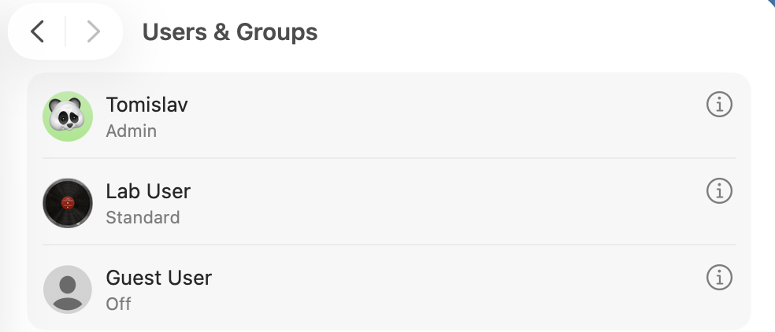

# IT-001 – macOS Workstation Administration

## Objective
Configure and verify local user accounts, permissions, and basic security settings on a macOS workstation.

## Lab Environment
- Device: MacBook Pro 14-inch (Apple M5)
- Operating System: macOS Tahoe 26.1
- Administrator: Tomislav
- Standard User: labuser

## Tasks Completed
- Verified the macOS hardware and operating system configuration.
- Created and tested a standard local user account.
- Verified user identity and group membership using Terminal.
- Confirmed that labuser does not have administrator privileges.
- Checked Secure Token, APFS Volume Ownership, and FileVault status.

## Verification
- Username: labuser
- UID: 502
- Primary Group: staff
- Administrator Membership: No
- Secure Token (primary administrator): Enabled
- FileVault: Disabled

## Result
PASSED – Local user administration and security baseline verification completed.

## Screenshots

