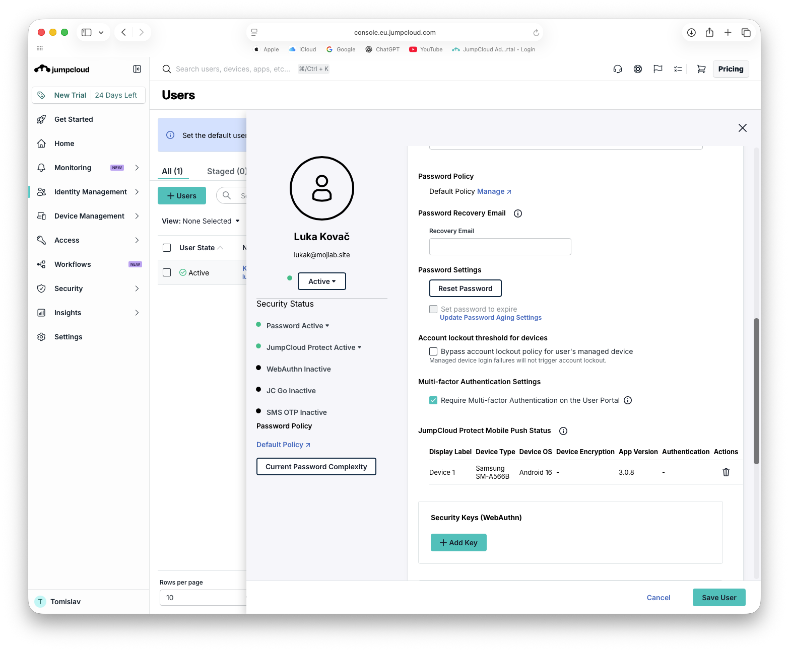
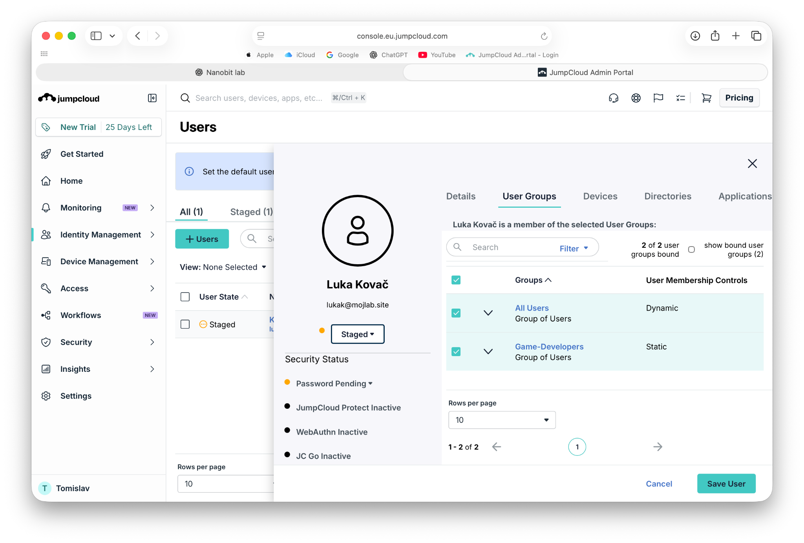

# IT-002 – JumpCloud Identity and Access Management

## Objective
Simulate employee onboarding and configure secure access using JumpCloud.

## Lab Environment
- Platform: JumpCloud (EU tenant)
- Test User: Luka Kovač
- Username: lukak
- User Group: Game-Developers
- MFA: JumpCloud Protect (Android)

## Tasks Completed
- Created a new user account in the Staged state.
- Created the Game-Developers user group.
- Assigned the user to the group.
- Activated the account and configured a password.
- Enrolled an Android device in JumpCloud Protect.
- Enabled mandatory MFA for User Portal access.
- Successfully tested user login with password and MFA.
- Reviewed Apple MDM, security policies, and software management.

## Verification
- User Status: Active
- Password Status: Active
- Group Membership: Game-Developers
- JumpCloud Protect: Active
- MFA Authentication: Successful
- MDM: Configuration reviewed; no device enrolled.

## Result
PASSED – User onboarding, group management, and MFA verification completed successfully.

## Issues Encountered

### SAML SSO Authentication Failure

**Issue:** The original DEMO-RSA SAML application was visible in the JumpCloud User Portal, but SSO authentication failed.

**Investigation:**

- Verified user authentication and JumpCloud Protect MFA.
- Confirmed that the application was assigned to the Game-Developers group.
- Examined HTTP redirects using browser Developer Tools.
- Reviewed SAML configuration, IdP metadata, and EU-region endpoints.
- Analyzed authentication events in JumpCloud Directory Insights.

**Error recorded in Directory Insights:**

```text
error_message: application unreachable
sso_token_success: false
```

**Resolution:**

Created a new SAML 2.0 application named DEMO-RSA-EU-TEST with a unique EU-region IdP URL.

Configured:
- IdP Entity ID: JumpCloud-Nanobit-EU-Test
- SP Entity ID: IAMShowcase
- ACS URL: https://sptest.iamshowcase.com/acs
- NameID: email
- NameID Format: emailAddress
- Signature Algorithm: RSA-SHA256
- Signing: Assertion and Response
- Assigned the Game-Developers group.

**Verification:**

Successfully authenticated to the IAMShowcase RSA Test Service Provider using the new SAML connector.

The Service Provider confirmed successful federation for lukak@mojlab.site.

**Root Cause:**

The original connector failed to complete SAML authentication. Creating a new connector resolved the issue, but the precise underlying cause of the original failure was not conclusively identified.

**Lesson Learned:**

SAML troubleshooting requires verifying authentication events, IdP and SP configuration, redirect behavior, and application assignments rather than assuming that successful user authentication guarantees successful SSO.

## Screenshots
### User Account and MFA Verification



### User Group Membership


