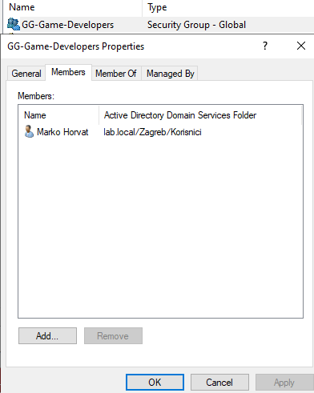
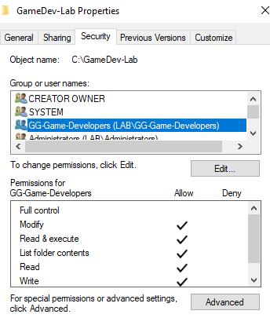

# IT-003 – Windows Server & Active Directory

## Objective
Simulate employee onboarding and configure secure access to a shared folder using Active Directory security groups.

## Lab Environment
- Windows Server 2022 – Active Directory Domain Services (AD DS)
- Domain: lab.local
- Windows 11 virtual machine – Microsoft Entra joined
- SMB file sharing and NTFS permissions

## Tasks Completed
1. Created an AD user account for Marko Horvat (mhorvat).
2. Created the security group GG-Game-Developers.
3. Added the user to the security group.
4. Created the folder C:\GameDev-Lab on Windows Server.
5. Assigned NTFS Modify permissions to GG-Game-Developers.
6. Configured SMB sharing with Change and Read permissions for the group.
7. Accessed the shared folder from Windows 11 using domain credentials.

## Verification
- Verified AD group membership.
- Successfully authenticated as LAB\mhorvat to access the SMB share.
- Created Marko-Test.txt from Windows 11, confirming write access.

## Result
Successfully implemented and tested group-based access to a Windows Server SMB share using Active Directory authentication and NTFS permissions.

## Screenshots
### 1. Active Directory Group Membership

Verified that the user Marko Horvat is a member of the GG-Game-Developers security group.

### 2. NTFS Folder Permissions

Configured Modify permissions for the GG-Game-Developers security group on the GameDev-Lab folder.

