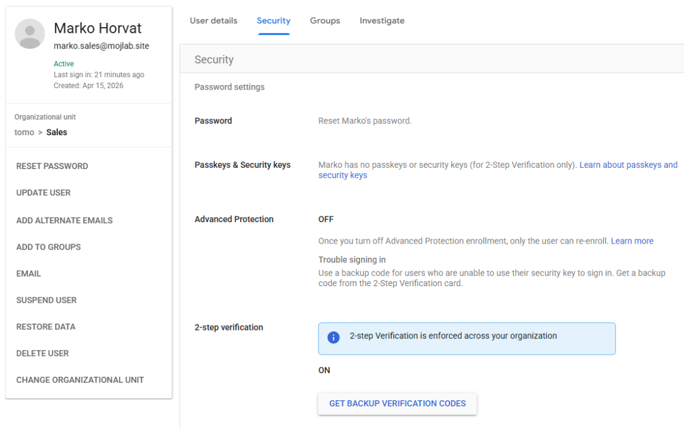
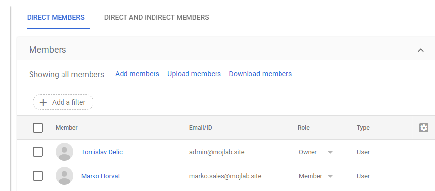

# IT-004 – Google Workspace Administration

## Objective
Simulate employee account administration, MFA configuration, and access management in Google Workspace.

## Lab Environment
- Google Workspace Admin Console
- Domain: mojlab.site
- Test user: Marko Horvat (marko.sales@mojlab.site)
- Google Authenticator
- Organizational Unit: Sales

## Tasks Completed
1. Reviewed the existing user account and organizational structure.
2. Reset the user's password and verified successful sign-in.
3. Configured Google Authenticator and enabled 2-Step Verification.
4. Successfully tested MFA authentication.
5. Moved the user to the Sales organizational unit.
6. Verified that MFA enforcement is enabled for the Sales OU.
7. Confirmed the user's membership in the Sales group.

## Verification
- User successfully authenticated with password and MFA.
- 2-Step Verification status: ON.
- MFA enforcement confirmed for Sales OU.
- Sales group membership verified.

## Result
Successfully validated Google Workspace user administration, organizational unit policies, group membership, and MFA authentication.

## Screenshots

### 1. MFA Configuration and Enforcement

Verified that 2-Step Verification is enabled for Marko Horvat and enforced through the Sales organizational unit.

### 2. Sales Group Membership

Confirmed that Marko Horvat is a member of the Sales group.

